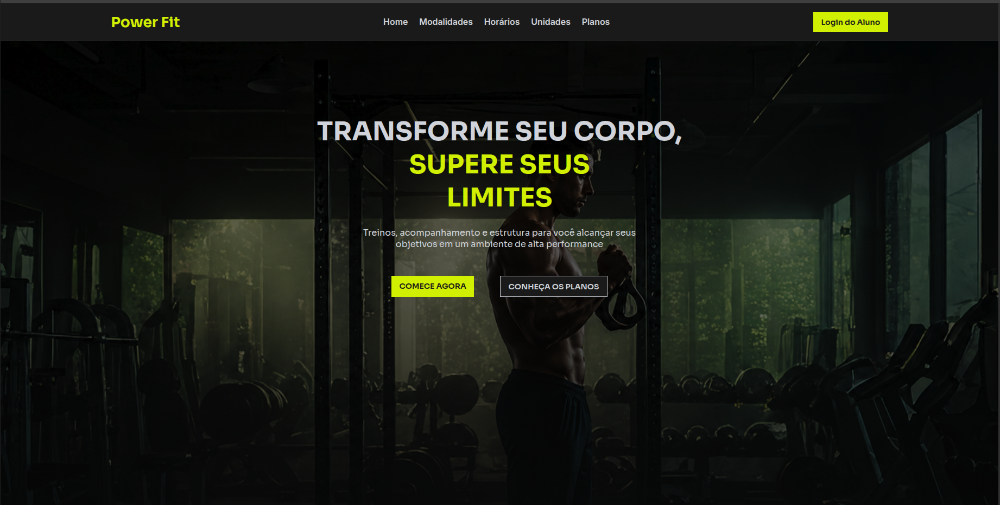

# Power Fit — Gym Landing Page

A multi-page website for a fictional gym brand, built with **HTML, CSS and JavaScript** as a group assignment at university. The brief was to build a themed website: our team chose a gym, created the brand identity and designed the pages from scratch.

## Screenshots

<!--  -->


## Pages

| Page | File |
| --- | --- |
| Home | `index.html` |
| Login | `login.html` |
| Register | `register.html` |
| Profile | `profile.html` |

The login, registration and profile pages are front-end only.

## Tech stack

- HTML5
- CSS3
- JavaScript

No frameworks, no build step and no dependencies.

## Running locally

```bash
git clone https://github.com/brunocmg/power-fit-landing-page.git
```

Then open `index.html` in your browser.

## Project structure

```
.
├── index.html
├── login.html
├── register.html
├── profile.html
├── assets/
│   ├── imgs/
│   └── songs/
├── css/
├── js/
├── docs/
└── README.md          
```

<!-- Optional: add links to the pitch and the presentation video here. -->
## Demo

```
https://youtu.be/OP7eTwUdBLo
```

## Team

- [Bruno Gomes](https://github.com/brunocmg)
- [Adrickson](https://github.com/adrickson)
